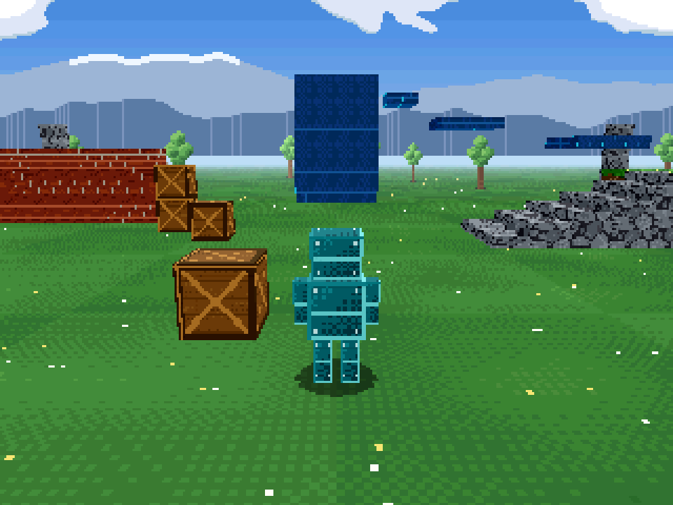

# Gridfin

A 3D action game in modern C++ that looks and behaves like a **Sega Saturn** game, running natively on
**Windows, Linux and macOS** and in the **browser** (WebAssembly + WebGPU). The player moves through the world
in a third person view that zooms smoothly into first person, using a controller or mouse and keyboard.



The renderer is not a shader filter over a modern pipeline. It models the Saturn's two video chips:

- **VDP1** draws quads (not triangles) from a 32-byte-per-entry command table kept in an exact 512 KB VRAM image.
  Each quad stretches its texture over itself exactly once, with no filtering and no perspective correction.
  There is no depth buffer: the CPU sorts polygons into an ordering table, as SGL did.
- **VDP2** draws the backgrounds: a per-scanline colour sky, a scrolling cloud and mountain plane, and an infinite
  "rotation plane" floor.
- Output is 320x224 pixels in 15-bit colour, shown at 4:3.

See [docs/SATURN.md](docs/SATURN.md) for what is emulated and where it deviates from the real hardware.

## Tech stack

| Area | Choice |
| --- | --- |
| Language | C++23 |
| Build | CMake ≥ 3.25 with presets, Ninja Multi-Config, dependencies fetched automatically |
| Window, input, gamepads, main loop | [SDL3](https://libsdl.org) (desktop and Emscripten) |
| Graphics | WebGPU (`webgpu.h`): [wgpu-native](https://github.com/gfx-rs/wgpu-native) on desktop (Vulkan / Metal / D3D12), Dawn's [emdawnwebgpu](https://dawn.googlesource.com/dawn/+/refs/heads/main/src/emdawnwebgpu/) in the browser |
| Shaders | WGSL, embedded at build time, hot-reloadable in dev builds |
| Web | Emscripten (`--use-port=emdawnwebgpu`) |
| Math / tests | glm, doctest + CTest |
| Tooling | clangd, clang-format, clang-tidy, VS Code workspace, GitHub Actions (all platforms + GitHub Pages) |

## Getting started

### Prerequisites

- CMake 3.25 or newer, Ninja, Git, and a C++23 compiler: GCC 13+, Clang 17+, Apple Clang 15+ (Xcode 15+), or
  MSVC 17.8+ (Visual Studio 2022).
- **Linux:** the X11/Wayland development headers that SDL needs, for example on Debian/Ubuntu:
  ```sh
  sudo apt install ninja-build libx11-dev libxext-dev libxrandr-dev libxcursor-dev libxi-dev libxss-dev \
    libxtst-dev libxfixes-dev libxkbcommon-dev libwayland-dev libdecor-0-dev libegl-dev libudev-dev libdbus-1-dev
  ```
- **Windows:** run the commands from a *Developer PowerShell for VS 2022* (so Ninja finds MSVC), or open the folder
  in Visual Studio, which reads `CMakePresets.json`.
- **Web:** an activated [emsdk](https://emscripten.org/docs/getting_started/downloads.html), version 4.0.10 or newer
  (`emsdk install latest && emsdk activate latest`, then source `emsdk_env`). You also need a browser with WebGPU:
  current Chrome, Edge, Safari or Firefox.

### Desktop

```sh
cmake --workflow --preset dev        # configure + build (Debug) + run the tests
cmake --build --preset debug --target run
```

The binary ends up in `build/native/bin/<Config>/`. Use `--preset release` for an optimised build.

### Browser

```sh
cmake --workflow --preset web                         # configure + build (Release)
cmake --build --preset web-release --target serve     # serves http://localhost:8080
```

Use `web-debug` for a build with assertions and source maps. The CI publishes the web build to GitHub Pages
when you push to `main` (enable Pages with **GitHub Actions** as the source).

## Controls

| Action | Keyboard and mouse | Controller |
| --- | --- | --- |
| Move | WASD / arrow keys | Left stick |
| Look | Mouse (click to capture, Esc to release) | Right stick |
| Jump (hold for a higher jump) | Space | A / Cross |
| Run | Shift | Left stick click, X / Square, or left trigger |
| Zoom; zooming all the way in gives first person | Mouse wheel | D-pad up / down |
| Toggle first / third person | V | Y / Triangle, or right stick click |
| Scanlines / scaling mode (4:3, integer, stretch) | F2 / F3 | |
| Reload shaders (dev builds) | F5 | |
| Fullscreen | F11 or Alt+Enter | |
| Save a 320x224 screenshot (`.bmp`; a download on the web) | F12 | |

## Developer workflow

- **Editor:** open the folder in VS Code and install the recommended extensions (clangd, CMake Tools, CodeLLDB,
  WGSL). CMake Tools picks the presets up. `compile_commands.json` is exported, so clangd works out of the box.
  CLion and Visual Studio read the presets as well.
- **Shader hot reload:** the `native` preset embeds the WGSL files and also reads them from `shaders/` at runtime.
  Edit a shader and press **F5**. On a compile error the old shaders stay and the error is logged.
- **Tests:** `ctest --preset debug`. The engine library (`src/saturn`, `src/game`) has no SDL or GPU dependency, so
  everything up to the VDP1 command table can be unit tested.
- **Headless runs:** `gridfin --frames 60 --screenshot out.bmp [--first-person]` renders 60 frames with a fixed time
  step, saves the VDP framebuffer and exits. CI uses this as a smoke test on a software Vulkan driver.
- **Formatting and linting:** `.clang-format` and `.clang-tidy` are included. CI checks formatting
  (`git ls-files '*.cpp' '*.hpp' | xargs clang-format -i` fixes it).
- **Dependency versions** are set in `cmake/Dependencies.cmake` and `cmake/WebGPU.cmake`. The wgpu-native downloads
  are pinned by SHA-256.

## Project layout

```
cmake/            Build helpers: dependencies, WebGPU provider, warnings, shader embedding
shaders/          WGSL: vdp.wgsl (VDP1 + VDP2), present.wgsl (scaling to the window)
src/core/         Logging, math helpers
src/saturn/       The emulated hardware model: VDP1/VDP2 memory, command format, geometry stage
src/game/         Game logic: assets (procedural, in Saturn formats), world, player, camera rig
src/gfx/          WebGPU: device bring-up, window surfaces, the renderer that executes the VDP model
src/platform/     SDL3 input mapping (keyboard, mouse, gamepads)
src/app/          App lifecycle, screenshots
tests/            doctest unit tests
web/shell.html    The page hosting the web build
```
